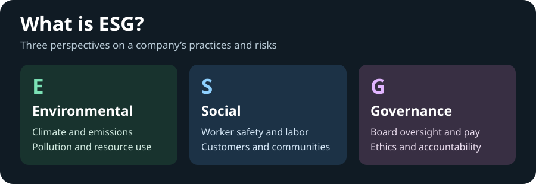
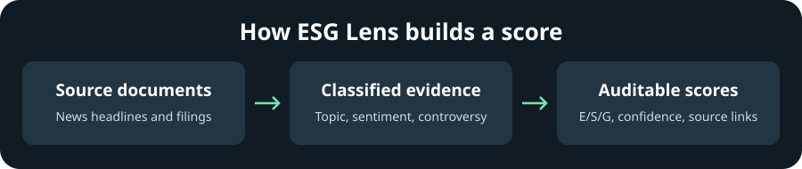

# ESG Lens

ESG Lens is a local research tool for exploring environmental, social, and governance signals for US-listed companies. It collects public evidence, classifies it with CPU-based NLP, and exposes scores and their sources through FastAPI.

## What is ESG?

ESG stands for **Environmental, Social, and Governance**. Environmental covers areas such as emissions and pollution. Social covers how companies affect workers, customers, and communities. Governance covers board oversight, executive pay, and business conduct.



## How it works

ESG Lens collects recent headlines from Google News RSS, filing sections from SEC EDGAR, and company metadata from Yahoo Finance. GDELT and SEC litigation RSS are optional sources. FinBERT classifies ESG topics and estimates financial sentiment. A separate controversy lexicon captures terms that triggered a penalty.



The API returns confidence alongside the score, identifies missing pillars, and links the strongest contributions to their source documents. If evidence is too thin, it returns `insufficient_data` and a null score. Each score keeps an evidence snapshot and a hash of the scoring configuration used to produce it.

## Run locally

Use Python 3.11 or 3.12 and run these commands from the repository root. The first model startup downloads the NLP weights. The application runs on CPU and the default sources require no paid API keys.

```bash
git clone https://github.com/PaddyCH96/esg-lens.git
cd esg-lens
python3.12 -m venv .venv
source .venv/bin/activate
python -m pip install --upgrade pip
# Linux only, install the CPU wheel before installing the project:
# python -m pip install --index-url https://download.pytorch.org/whl/cpu torch==2.6.0
python -m pip install -e '.[nlp,dev]'
python -m spacy download en_core_web_sm
cp .env.example .env
```

Set `CONTACT_EMAIL` and `USER_AGENT` in `.env` with your own contact address before using EDGAR. Then run:

```bash
uvicorn esg_lens.api.main:app --host 127.0.0.1
```

Open [the interactive API docs](http://127.0.0.1:8000/docs). The app initialises SQLite at startup. Wait for `GET /api/v1/healthz` to return 200 before submitting a job. A persistent 503 means model startup did not finish successfully. Check the server log for details.

## Analyse a portfolio

```bash
curl -s http://127.0.0.1:8000/api/v1/portfolio/analyze \
  -H 'Content-Type: application/json' \
  -d '{"tickers":["AAPL","XOM"]}'
```

1. Poll the URL in `links.status` until the job finishes.
2. Open `/api/v1/company/XOM/score` to see the composite, confidence, pillars, and source links.
3. Use `/api/v1/company/XOM/documents` to inspect evidence and exclusion reasons or `/api/v1/company/XOM/history` to compare runs.

Use `"sources": ["google_rss", "edgar", "yfinance", "sec_litigation"]` to include SEC
litigation notices. To use GDELT, add `gdelt` explicitly. Google News RSS is best effort and
can return Google wrapper links. Evidence identifies those links and records the publisher
when available. The score response includes the earliest and latest stored dates for each
source. The analysis window can be wider than the evidence the feed actually returned.

Results can be partial when a source fails. The job response shows which tickers were affected. The portfolio average gives equal weight to companies with a score.

## Tests and validation

```bash
# The reserved .test address is only for mocked HTTP requests in the suite.
USER_AGENT='ESG Lens offline tests (ci@esg-lens.test)' python -m pytest -q
python scripts/sensitivity.py
```

The worked scoring fixture and API flow tests run with recorded documents or stub inference. They exercise scored and unscored results, duplicate analysis, evidence retrieval, and job recovery. After collecting live scores, the sensitivity command perturbs each category and pillar weight by ±25%, then reports rank stability, the largest score movement, and benchmark rank correlation for up to 50 stored companies. An empty, constant, or insufficient sample has no correlation value.

### Live validation results

A clean Linux checkout on November 7, 2026 passed **105 tests** and ran the API with the real
CPU models. Google News RSS returned evidence for both tickers. Yahoo Finance metadata requests
failed, so the job reported partial success. The repeat run left the database at 43 raw documents
and 42 signals.

| Company | Source | Documents used in the analysis | Observed coverage (UTC) | Outcome |
|---|---|---:|---|---|
| Apple (AAPL) | Google News RSS | 18 | Aug 28 – Nov 6, 2026 | Scored |
| Exxon Mobil (XOM) | Google News RSS | 24 | Aug 14 – Nov 4, 2026 | Insufficient evidence to assign a score |

The initial two-company job took **6.0 seconds** after model startup, and the repeat took **3.0
seconds**. Across the full 17-company sample, 12 companies received a score. Across 58 weight
perturbations, the lowest rank correlation with the baseline was **0.979** and the largest score
movement was **3.38 points**. No paired external ESG ratings were available, so external
correlation is unreported. These are results from one run, with source and publisher coverage
specific to the query window.

The live SEC litigation feed and EDGAR filings for both companies were checked directly. The hosted
API run used Google News RSS and Yahoo Finance. To include the SEC collectors in a local rerun, set
a real SEC contact in `.env` and run the following while the API is up:

```bash
python -m scripts.live_validation --edgar --benchmark
```

Google News RSS is intended for personal, non-commercial use. Use SEC sources or another
appropriately licensed provider for other uses.

[Clean checkout, test output and validation report](https://github.com/PaddyCH96/esg-lens/actions/runs/42381493995).

## Limitations

- The pipeline focuses on English evidence and US-listed companies. GDELT coverage and headline-level classification can miss context and underrepresent less covered companies.
- Filings are self-reported and may contain selective disclosure or greenwashing. Financial sentiment can differ from the ESG impact of an event. The controversy matcher can miss context.
- The methodology uses configurable judgment-based weights. News, filings, and external ratings can update on different schedules. External scores are shown for comparison only, and providers may use opposite score directions.
- ESG Lens is a transparent research signal. Its results are not audited ratings or investment advice.

[Methodology](docs/scoring_methodology.md) · [API contract](docs/api_design.md) · [Research notes](docs/research_notes.md) · [MIT license](LICENSE)
